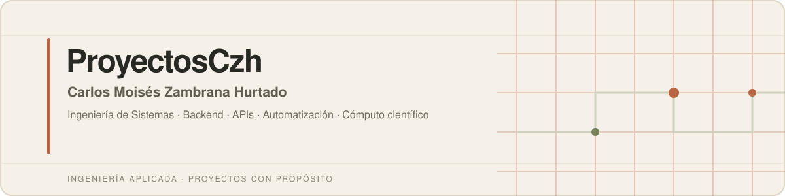
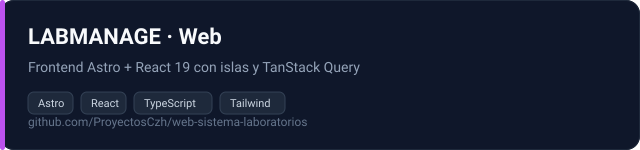
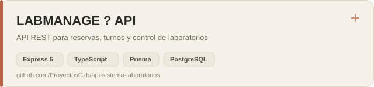
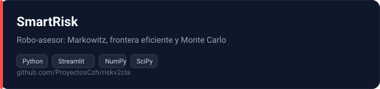
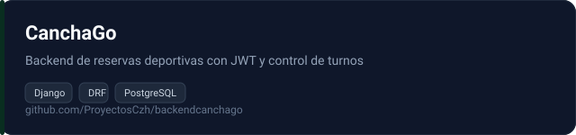
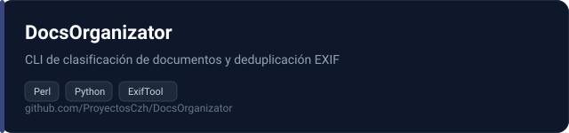
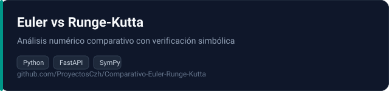
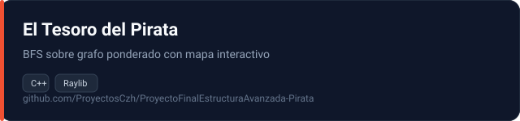
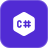

  

   

  <h3>Carlos Moisés Zambrana Hurtado</h3>
  
<strong>Ingeniería de Sistemas · Backend · APIs · Automatización · Cómputo científico</strong>

  

    
    
    
  

---

## `01` · Sobre el proyecto

**ProyectosCzh** es mi laboratorio de ingeniería: un espacio donde cada repositorio es un sistema completo, con su arquitectura, su base de datos, sus pruebas y su documentación.

Trabajo el ciclo completo de desarrollo —levantamiento y análisis de requerimientos, historias de usuario, MVPs iterativos, pruebas de APIs y despliegue— bajo marcos ágiles (**Scrum** y **Kanban**), con énfasis en **código limpio**, **contratos tipados** y **validación continua**.

| Enfoque | Descripción |
| :--- | :--- |
| **Arquitectura** | Diseño de APIs REST, modelado de dominio y persistencia relacional. |
| **Automatización** | Herramientas CLI de línea de comandos para tareas operativas del día a día. |
| **Cómputo** | Modelado numérico, simulación financiera y análisis de datos. |
| **Estructuras de datos** | Implementaciones propias de TADs: tablas hash, AVL, grafos, listas y colas. |

---

## `02` · Proyectos destacados

### `LABMANAGE` · Plataforma de gestión de laboratorios

Suite full-stack para la administración y control operativo de laboratorios: reservas de aulas y turnos, estados por aula, asignación de docentes, mantenimiento y estadísticas en vivo.

| Capa | Repositorio | Stack |
| :--- | :--- | :--- |
| **Frontend** | [web-sistema-laboratorios](https://github.com/ProyectosCzh/web-sistema-laboratorios) | `Astro 7` `React 19` `TypeScript` `Tailwind 4` `TanStack Query` |
| **API** | [api-sistema-laboratorios](https://github.com/ProyectosCzh/api-sistema-laboratorios) | `Node.js` `Express 5` `TypeScript` `Prisma` `PostgreSQL` `Zod` |

<b>Detalles técnicos</b>

- **Frontend:** Astro en modo `server` con islas React `client:only`, estado de sesión en `localStorage`, capa de API con interceptores de autenticación y manejo de errores, TanStack Query como única fuente de verdad del estado remoto.
- **API:** Express 5 + TypeScript estricto, ORM Prisma sobre PostgreSQL (Neon), caché en memoria con invalidación *write-through* y deduplicación *single-flight*.
- **Seguridad:** doble token (access JWT 15 min + refresh JWT 7 días) con sesiones persistidas, `bcryptjs`, Helmet, CORS con credenciales, *rate limiting* por endpoint y validación Zod en el límite.
- **Documentación:** referencia interactiva con Scalar y especificación OpenAPI 3.x.

---

### `SmartRisk` · Robo-asesor académico con simulación de portafolios

Plataforma web de simulación financiera y dimensionamiento automatizado de portafolios. Aplica TADs, hashing y persistencia a un problema real: la optimización de portafolios de inversión mediante métodos de *Financial Engineering*.

| Detalle | Descripción |
| :--- | :--- |
| **Motor financiero** | Optimización de **Markowitz** (máxima razón de Sharpe y mínima varianza) con frontera eficiente y **Simulación Monte Carlo** sobre GBM. |
| **Stack** | `Python 3.11` `Streamlit` `NumPy` `SciPy` `Pandas` `Plotly` `yfinance` |
| **Persistencia** | JSON con *sharding* por usuario y escritura atómica. |
| **Repositorio** | [riskv2cla](https://github.com/ProyectosCzh/riskv2cla) |

### `CanchaGo` · Backend de reservas deportivas

Servicio backend con la lógica de negocio y la gestión de reservas de canchas: autenticación, disponibilidad de horarios y control de turnos.

| Detalle | Descripción |
| :--- | :--- |
| **Stack** | `Python` `Django 5` `Django REST Framework` `JWT` `PostgreSQL` `Gunicorn` |
| **Repositorio** | [backendcanchago](https://github.com/ProyectosCzh/backendcanchago) |

---

### `DocsOrganizator` · Organizador de documentos con eliminación de duplicados

Utilidad de línea de comandos para clasificar documentos automáticamente y eliminar duplicados mediante metadatos EXIF/QuickTime con ExifTool.

- **Modo copia estricto por defecto:** la biblioteca original nunca se modifica.
- Ordena por **fecha de captura real** en carpetas `Año\Mes`, independiente de la fecha del sistema de archivos.
- Detección de duplicados en **dos fases**: muestra rápida por tamaño + hash, y confirmación total por MD5.
- **Trazabilidad total:** cada operación queda registrada en CSV, con bitácora de respaldo e importación incremental reanudable.

| Detalle | Descripción |
| :--- | :--- |
| **Stack** | `Perl` `Python` `ExifTool` `CLI` |
| **Repositorio** | [DocsOrganizator](https://github.com/ProyectosCzh/DocsOrganizator) |

### `Comparativo Euler vs. Runge-Kutta` · Análisis numérico

Implementación y análisis comparativo entre los métodos de Euler y Runge-Kutta, con verificación simbólica de las soluciones y medición de los errores de aproximación.

| Detalle | Descripción |
| :--- | :--- |
| **Stack** | `Python` `FastAPI` `SymPy` `Uvicorn` |
| **Repositorio** | [Comparativo-Euler-Runge-Kutta](https://github.com/ProyectosCzh/Comparativo-Euler-Runge-Kutta) |

---

### Proyectos de estructuras de datos

| Repositorio | Descripción | Stack |
| :--- | :--- | :--- |
| **[El Tesoro del Pirata](https://github.com/ProyectosCzh/ProyectoFinalEstructuraAvanzada-Pirata)** | Juego de búsqueda de caminos con **BFS** sobre un **grafo ponderado**, mapa interactivo con *pan* y *zoom* sincronizado, y **árbol de pistas n-ario**. | `C++` `Raylib` |

---

## `03` · Stack tecnológico

| Área | Tecnologías |
| :--- | :--- |
| **Lenguajes** |         |
| **Frontend** |       |
| **Backend & APIs** |         |
| **Bases de datos** |     |
| **Datos & Cómputo** |       |
| **Móvil & Escritorio** |    |
| **QA & Herramientas** |        |
| **Cloud & Despliegue** |     |

---

## `04` · Metodología y trayectoria

| Área | Detalle |
| :--- | :--- |
| **Flujo de ingeniería** | Levantamiento de requerimientos, historias de usuario, desarrollo iterativo de MVPs, pruebas de APIs y documentación técnica. |
| **Calidad** | Código limpio, tipado estricto, validación en el límite de la API y pruebas automatizadas. |
| **Documentación** | README técnico por proyecto con arquitectura, modelo de datos, flujo de uso y scripts reproducibles. |
| **Desarrollo freelance** | `2025 — Presente` · Aplicaciones a medida, integración de APIs y herramientas de análisis de datos en coordinación directa con clientes. |

---

### ¿Tienes una idea de proyecto o buscas colaborar en código?

Escríbeme por correo o LinkedIn — respondo siempre.

 

&nbsp;

&nbsp;

  

Hecho por <a href="https://github.com/ProyectosCzh">ProyectosCzh</a>

